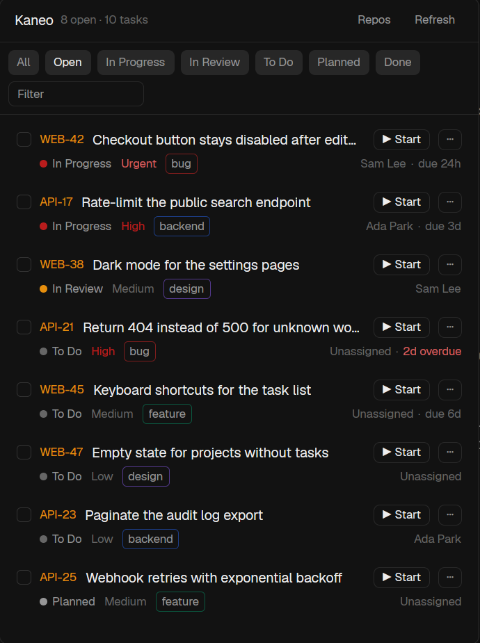

# Kaneo for Herdr

A [Herdr](https://herdr.dev) mod for self-hosted [Kaneo](https://kaneo.app): every task on your boards in one panel.
Select tasks and press **Start**, and each one gets its own git worktree and a coding agent working on it.



## What it does

- Lists every task in your Kaneo workspaces: each column, planned tasks too, open work first. It leaves out archived tasks.
- Filter by `Open`, by any of your columns (custom ones too), or by id, title, project, status or assignee.
- 40 tasks a page, so big boards stay quick. Loaded tasks are shared between the docked panel and the popup
  and kept across restarts, so the panel opens with your tasks already there and refreshes in the background.
- Click a task's id to open it in Kaneo.
- **▶ Start** on a task, or select several and **▶ Start N agents**. Each task gets a worktree on a branch
  like `web-7-fix-the-login-bug` and an agent whose first message is the task. Kaneo's GitHub integration
  links that branch back to the task.
- **⋯** opens the full dialog: repository, branch, your own instructions, a skill to run first, agent, model,
  reasoning level and subagents. Start then reuses whatever you last picked there.
- **Repos** shows which repo each project works in, and lets you change it.

## Which repo a project works in

The first match wins:

1. A repo you picked under **Repos**. It's remembered, and **Automatic** undoes it.
2. `repos` in `kaneo.json`.
3. The project's **GitHub, GitLab or Gitea link in Kaneo**, matched to a clone on this computer by its
   `origin`. Without a clone, it's cloned into `cloneRoot` on the first Start.
4. A repo named like the project.
5. Otherwise Start asks you: pick a repo found on this computer, or paste a git URL to clone.

Repos are searched up to three folders deep under `~/Projects`, `~/projects`, `~/dev`, `~/code`, `~/src`,
`~/repos`, `~/git`, `~/work` and `~/Developer`, or the folders in `repoRoots`.

## Install

Tell your coding agent:

```
Read ~/.config/herdr-app/AGENTS.md, then add this mod: https://github.com/prodBirdy/herdr-kaneo
```

Or by hand:

```sh
git clone https://github.com/prodBirdy/herdr-kaneo && cd herdr-kaneo
cp -R mods/kaneo mods/kaneo-agent ~/.config/herdr-app/mods/
```

Then add `"ctrl-shift-y": "mod.open:kaneo"` to the `global` section of `~/.config/herdr-app/keys.json`.
That shortcut opens it as a popup. To dock it as a side panel, put a block with `{ "mod": "kaneo" }` into a
cloned layout. Its `kaneo.refresh` and `kaneo.repos` commands can be bound to keys.

## Set up

Create an API key in Kaneo (Settings → Account → API Keys), then:

```sh
cat > ~/.config/herdr-app/kaneo.json <<'EOF'
{ "url": "https://kaneo.example.com", "apiKey": "..." }
EOF
chmod 600 ~/.config/herdr-app/kaneo.json
```

Or export `KANEO_URL` and `KANEO_API_KEY` in your shell instead. Everything else is optional:

```json
{
  "url": "https://kaneo.example.com",
  "apiKey": "...",
  "apiUrl": "https://kaneo.example.com/api",
  "workspaces": ["my-workspace"],
  "repos": { "WEB": "~/src/web" },
  "repoChoices": ["~/src/docs"],
  "repoRoots": ["~/src", "~/work"],
  "cloneRoot": "~/src",
  "branchPattern": "{slug}-{number}-{title}"
}
```

`"demo": true` shows made-up tasks without a server, which is handy for trying it out.

## What it touches

- **Network:** only your Kaneo instance (your key is sent nowhere else), plus `git fetch` and `git clone`
  when an agent starts.
- **Rate limit:** Kaneo allows each API key 100 requests a minute. However many copies of the panel are open,
  only one reloads each minute (a few requests per project). Each project's git link is cached for an hour, and
  a rate limit is waited out instead of retried.
- **Programs:** `git`, `sh` (finding repos, reading `KANEO_*`), the agents' CLIs (listing models) and your
  system's URL opener.
- **Files:** reads `~/.config/herdr-app/kaneo.json`. Lists git checkouts under the repo roots and reads their
  `origin`. Never keeps or shows credentials in a remote URL. Creates worktrees under `~/.herdr/worktrees`.
- **Agents:** the task's description goes into the agent's first message, and the agent is asked to push and
  open a PR. It runs with whatever permissions its own config gives it.

## Develop

```sh
node --test tests/
herdr-app check mods/kaneo && herdr-app check mods/kaneo-agent
```

Mods can't import from each other's folders, so `mods/kaneo-agent` has copies of `start.js`, `task.js` and
`agents.js`. Edit the ones in `mods/kaneo` and copy them over. [`RECIPE.md`](RECIPE.md) is the full brief
for rebuilding the mod from an empty folder.

## License

[MIT](LICENSE). Ported from [dantech99/herdr-linear](https://github.com/dantech99/herdr-linear) (MIT).
The agent dialog comes from `issue-agent` in
[obrunogonzaga/herdr-mods](https://github.com/obrunogonzaga/herdr-mods) (MIT).
