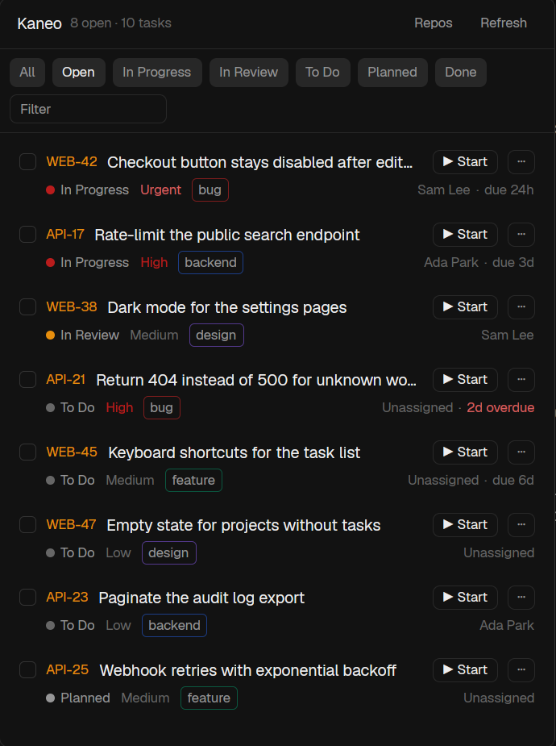

# Kaneo

Every task from a self-hosted Kaneo instance in one panel, with a `Start` button that gives each selected
task its own git worktree and a coding agent working on it. Projects find their repo by themselves:
Kaneo's GitHub/GitLab/Gitea link, else a repo with the project's name, else you pick or clone one. It
opens as a popup (`ctrl-shift-y`) and fits a side panel of a cloned layout just as well.

## What you see

**The panel**: one column on `background`, base type 13px, no border of its own. A popup is 460×620.
Top to bottom:

- **Header**, 42px, 14px side padding, 6px gaps, a 1px `border` line under it: `Kaneo` semibold, then
  `8 open · 10 tasks` in 11px `dim` (truncating), then two 26px buttons (8px padding, radius 7, 11px):
  `Repos` (`selected`/`foreground` while its view shows, else `muted`) and `Refresh` (`…` while loading).
- A notice line in 11px `working`, under the header, after a rate limit while tasks are shown:
  `Kaneo rate limit reached; trying again after 10:42`.
- **Filter bar**, wrapping, 8px side and 7px vertical padding, 6px gaps, a `border` line under it. Chips are
  24px tall, 8px padding, radius 6, 11px: `All`, `Open` (the default), then one per column the loaded tasks
  are in, in this order: In Progress, In Review, To Do, Planned, custom columns by name, done columns last.
  The chosen chip is `selected`/`foreground`, the others `raised`/`muted`. After the chips, a 130×24 text
  field (`Filter`) whose border turns `accent` while it holds text.
- **The list**, scrolling, 6px padding, rows 2px apart. Each row is a radius 7 card with 10px side and 7px
  vertical padding, `hover` under the pointer and `selected` while selected:
  - Line one, 8px gaps: a 14px checkbox (radius 4, `input` border; `accent` fill with a ✓ when selected),
    the id `WEB-42` (11px `accent`, `foreground` on hover), the title (truncating; `muted` for done tasks),
    `▶ Start` (`…` while starting, `✓` once started) and `⋯`. Both buttons are 20px tall with 7px padding,
    radius 6, 11px and a `border` outline.
  - Line two, 11px `dim`, indented 22px: a 7px dot (`working` In Progress, `accent` In Review, `dim` To Do,
    `muted` Planned, `done` for done columns, `idle` otherwise) and the column name in `muted`. Then the
    priority (`Urgent` in `ansi1`, `High` in `working`, Medium/Low `dim`, none hidden) and up to two labels as
    pills (5px padding, radius 4, a border in the label's color at 53% alpha). On the right: the assignee or
    `Unassigned`, and `· due 3d`, `· due 5h` or `· 2d overdue` (`ansi1` unless done).
  - A third line in `ansi1` with the reason when a start failed.
- **Pager** (only with more than 40 matching tasks), 34px, a `border` line above, 11px: `41–80 of 230` in
  `dim`, then `«`, `‹ Prev`, `2 / 6` in `muted`, `Next ›` and `»`. They're `dim` and inactive at either end.
  A filter or chip change goes back to page 1. Each page has its own scroll position, so it starts at the top.
- **Selection bar** (only with something selected), on `chrome` with a `border` line above, 10×8 padding,
  11px. Line one: `3 selected` semibold, then what Start runs with in `dim` (`claude · opus · high`, or
  `Claude Code, its defaults · ⋯ on a task to change`). Line two: `Select shown`/`Unselect shown` (`… page` when paged, for the page shown), `Clear`,
  then a 28px `solid` button `▶ Start 3 agents` (`Starting…` while it works).
- In place of the list: `Loading…`, `No tasks yet`, `No tasks match these filters`, or in `ansi1` the missing
  URL or key message, `Invalid Kaneo API key`, `kaneo.json is not valid JSON` or Kaneo's own message.

**Repos view** (instead of the filter bar and the list), scrolling, 8px padding, 11px type: a `dim` line
explaining the order, then one radius 8 card per project with 8px padding and a `border` (`accent` while
open). The card shows the slug in `accent`, the project name, `Automatic` when one was picked, and
`Change`/`Done`. Under that, the repo folder (`~/…`) in `muted` with its source on the right in `dim`
(`picked`, `kaneo.json`, `Kaneo github link`, `clone from Kaneo github link`, `name match`), or
`No repo found: pick one` in `ansi1`. An open card adds a `Filter repos` field, a 220px scrolling list of
the checkouts found (26px rows: name, `worktree` for linked worktrees, the remote without credentials or
the folder in `dim`), `Or clone one into ~/Projects on first Start:` and a git URL field with a `Use` button.

**The agent dialog** (`⋯`, 480×660, `popover`, 16px padding, sections 14px apart, titled in 11px `dim`;
the title and footer stay put and the middle scrolls): `Start an agent on WEB-42` and the title.
Then **Repository** (chips when there are choices; the folder, plus `· cloned on Start` when it will be
cloned), **Branch** (30px input), **Instructions** (textarea, 3 to 8 rows), **Skill** (30px input, the
last one used), **Agent** (chips with icons, installed agents only), **Model** (a filter plus a 150px
list, `Agent's default` first), **Reasoning** (chips) and **Options** (`Ask it to use subagents`). The
footer has the error in `ansi1`, `Cancel` and `Start agent` in `solid`.

## How it behaves

- It doesn't show agent statuses. Nothing animates.
- **Loading:** it reads `GET /api/workspace`, then `GET /api/project?workspaceId=` for each workspace. For
  each project it reads `GET /api/task/tasks/{projectId}?limit=100&page=N&relatedPage=N` until
  `max(totalPages, relatedTotalPages)` (at most 20 pages). It keeps `data.columns[].tasks` (status = column
  slug, done = `isFinal`) and `data.plannedTasks`, never `archivedTasks`, and drops duplicates by id.
  Workspaces can be narrowed with `workspaces` (slug or id). Order: in progress, in review, to do, custom,
  planned, done; then priority, then number from newest.
- **Shared loading:** loaded tasks go into shared `kaneo.cache` as `{ at, url, issues, projects, error }`.
  Descriptions over 2000 characters are dropped there and fetched again on Start. Every copy draws from the
  cache, so a new popup shows the last load at once, even after a restart. On open and every 60 s, a copy
  loads only when the cache is over 50 s old and no other copy holds `kaneo.loading` (a timestamp, stale
  after 30 s). `Refresh` and `kaneo.refresh` always load. `kaneo.json` is read on open and on Refresh,
  not every minute. Herdr's `fetch` takes 1–2 s a request, so this is what keeps the panel quick.
- **Auth:** `Authorization: Bearer <apiKey>`, sent only to `apiUrl` (default `<url>/api`). `url`/`apiKey`
  come from `~/.config/herdr-app/kaneo.json`, else `KANEO_URL`/`KANEO_API_KEY` from the shell agents start
  in.
- **Rate limit:** Kaneo allows each API key 100 requests a minute. On a 429 the panel pauses until
  `Retry-After` (else `X-RateLimit-Reset`, else a minute). It keeps the tasks it has and shows the notice.
- **Rows:** a click toggles selection. A click on the id opens
  `<url>/dashboard/workspace/<ws>/project/<project>/task/<id>` on this computer, but only an `http(s)` link
  on the configured instance's origin.
- **Repos:** on open and on Refresh, `sh` lists checkouts under the repo roots: `find -maxdepth 3 -name .git`,
  skipping `node_modules`, `.cache` and `target`. A `.git` folder means a main checkout, a `.git` file a
  worktree. Each checkout's `origin` is read and normalized to `host/owner/repo` with any user, password or
  token dropped. Kaneo links come from `GET /api/{github,gitlab,gitea}-integration/project/{id}` and are
  cached in shared `kaneo.links` for an hour. Order: picked (shared `kaneo.repos`), `repos` in kaneo.json by
  slug, the link's local clone (a main checkout named like the repo, else any main one, else a worktree), a
  clone of the link into `cloneRoot` (default: the first repo root that exists), a main checkout named like
  the project's name or slug (slugified), else none.
- **Start** (a row's, or the bar's for the selection) asks nothing. For each task it finds the repo, the
  remembered choice (shared `kaneo-agent.last`, else Claude Code, else the first installed agent) and the
  full description (`GET /api/task/{id}/description` pages when the board deferred it). It clones when the
  repo is marked to clone and isn't there yet (`git clone -- <url> <dir>`), makes the worktree, and only
  then opens every space with `space.new { folder, tab: identifier, argv, task }`. Tasks whose project has
  no repo don't start: a warning names those projects and the Repos view opens on the first one. Failures
  show under the row and in one error notification.
- **Branch:** `branchPattern` from kaneo.json, else the project's Kaneo link's pattern, with `-{title}`
  added when the pattern has no `{title}` (Kaneo matches anything after the pattern), else
  `<slug>-<number>-<first five title words>`.
- **Worktree** (shared with the dialog): a branch already checked out is used where it is. Otherwise a
  worktree goes at `~/.herdr/worktrees/<repo>/<branch, slashes as dashes>`. A local branch is used as it
  is, a branch only on origin is tracked, and a new branch starts from `origin/<default branch>`, else
  `HEAD`.
- **Task:** one line: an optional skill, `Work on Kaneo task WEB-42: <title> (<url>).`, `Summary:`
  (flattened, 600 characters at most), optional `Instructions:`, an ask to read the full task through Kaneo
  access, where it is, AGENTS.md/CLAUDE.md, lint/typecheck/tests, conventional commits, push and a PR that
  mentions the id, and no merging or deploying.
- `"demo": true` in kaneo.json shows 10 made-up tasks in two projects without a server.

## Built from

- `mods/kaneo/main.js`: the panel, one `View`. `mod.json`:
  `{ "place": "none", "title": "Kaneo", "overlay": { "width": 460, "height": 620 } }`.
- `mods/kaneo/kaneo.js` (pure): `parseConfig`, `parseBoard`, `boardPages`, `sortIssues`, `statusChips`,
  `filterIssues`, `due`, `plainDescription`, `labelColor` (Kaneo's color names as Tailwind hex), `taskUrl`,
  `kaneoError`, `pickWorkspaces`, `repoOptions`.
- `mods/kaneo/repos.js` (pure): `SCAN_SCRIPT`, `DEFAULT_ROOTS`, `scanRoots`, `remoteKey`, `parseScan`,
  `linkFrom`, `resolveRepo`, `cloneProblem`.
- `mods/kaneo/start.js`: git and worktree helpers, `ensureClone`, `defaultChoice`, `prepare`.
  `task.js`: `branchFor`, `worktreeFolder`, `branchProblem`, `checkoutOf`, `taskFor`. `agents.js`: one
  adapter per agent CLI for models and flags (Claude Code, Codex, OpenCode, Cursor, Pi, Gemini).
  `demo.js`: the demo tasks. `urls.js`, `open.js`: the instance-only opener. `kaneo.svg`: a tab-bar icon.
- `mods/kaneo-agent/`: the dialog, opened with `openOverlay({ mod: "kaneo-agent", kind: "dialog",
  props: { issue, branchPattern, cwd, on, clone, repos } })`. It has copies of `start.js`, `task.js` and
  `agents.js`, because mods can't import across folders.
- `keys.json`: `{ "global": { "ctrl-shift-y": "mod.open:kaneo" } }`. Commands: `kaneo.refresh` and
  `kaneo.repos`.
- `herdr`: `exec`, `fetch`, `readTextFile`, `knownAgents`, `run`, `notify`, `openOverlay`, `shared`/`setShared`,
  `nextCommand`, `theme`, `home`, `appHome`, `window`.

## Watch out

- Draw only the page shown (40 rows): every change to Herdr's live data redraws the mod.
- Kaneo's assigned-tasks endpoint caps at 100 tasks. This mod reads the boards instead, so every task shows.
- Board pages and planned/archived pages count separately (`page`, `relatedPage`). Ask for both and drop
  duplicates.
- Descriptions are Markdown. Strip tags only when the text starts with `<`.
- The popup closes when focus moves (a new space shows). So make every worktree first and send all the
  `space.new` calls at the end.
- A rate-limit error inside the link lookup must be thrown, not swallowed, or "no links" gets cached for
  an hour.
- Never keep raw `origin` URLs: some carry tokens (`https://x-access-token:…@github.com/…`).
- `git clone --` and the URL check keep a typed URL from being read as an option.
- The API key is a secret: keep `kaneo.json` out of the mod folder and `chmod 600` it.
- Only this computer's repos are found and cloned. For a space on another machine, use the dialog.

## Done when

- `node --test tests/` passes, and so do `herdr-app check mods/kaneo` and `herdr-app check mods/kaneo-agent`.
- With `"demo": true`, `ctrl-shift-y` shows 8 open and 10 tasks, and the chips and the filter work.
- Without a URL or key, the panel says so. With a wrong key, it shows `Invalid Kaneo API key`.
- With a real instance, every non-archived task shows, done ones last under `Open` → `Done`.
- Repos lists every project. A project linked to GitHub resolves to its local clone, and to `clone from
  Kaneo github link` when there is none.
- `▶ Start` on a task of a linked project opens a new space on `~/.herdr/worktrees/<repo>/<slug>-<n>-…`,
  named after the id, with the task as the agent's first message.
- Start on a project without a repo opens Repos for it, and starts nothing.
